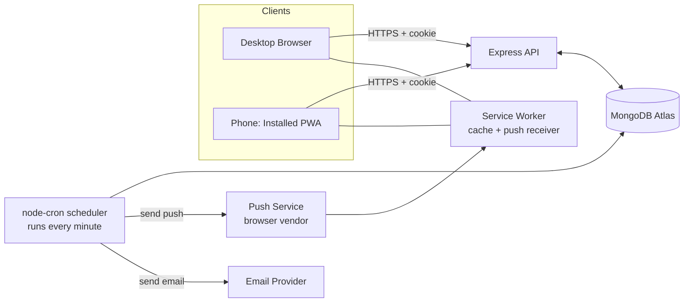
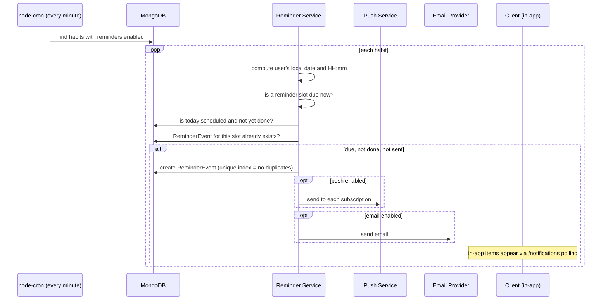

# Architecture: HabitTracker

> How the system is built. Product goals are in `PRD.md`, visuals in `Design.md`. Decisions made during the build are logged in `Memory.md`.

## 1. Tech Stack

| Layer | Choice | Why |
|-------|--------|-----|
| Frontend | **Vite + React** (JavaScript or TypeScript, see Section 12) | Fast dev server, plain React, easy to learn |
| Styling | **Tailwind CSS** | Required by shadcn/ui, utility classes |
| UI components | **shadcn/ui** (`github.com/shadcn-ui/ui`) | Accessible components copied into our code |
| Animated effects | **React Bits** (`github.com/DavidHDev/react-bits`) | Animated backgrounds, text, counters; used sparingly |
| Server state | **TanStack Query** | Caching, refetching, optimistic updates for grid clicks |
| Routing | **React Router** | Pages and protected routes |
| Backend | **Node.js + Express** | Classic MERN API |
| Database | **MongoDB (Atlas free tier) + Mongoose** | Document model fits habits and logs |
| Auth | **JWT in httpOnly cookie + bcrypt** | Email/password now; Google OAuth later |
| Validation | **Zod** (server) | Reject bad input early |
| Push | **web-push** library + VAPID keys + service worker | Standard Web Push |
| Email | **Nodemailer** with a provider (Resend or SendGrid free tier) | Transactional email |
| Scheduler | **node-cron** (runs every minute) | Finds reminders that are due |
| Dates | **date-fns** + **date-fns-tz** | Timezone-safe date handling |
| PWA | **vite-plugin-pwa** | Manifest + service worker generation |
| Hosting (later) | Vercel/Netlify (frontend), Render/Railway (backend), Atlas (DB) | Free-tier friendly |

## 2. System Overview



**Sync explained:** web and mobile are the *same* React app talking to the *same* API and database. Whatever one device saves, the other reads on its next fetch. There is no separate mobile code to keep in sync.

## 3. Folder Structure

```
HabitTracker/
├── README.md
├── .gitignore
├── docs/
│   ├── PRD.md
│   ├── Architecture.md
│   ├── Rules.md
│   ├── Design.md
│   ├── Tasks.md
│   ├── Memory.md
│   └── 1prompt.md
├── client/                      # Vite + React app
│   ├── public/                  # icons, manifest assets
│   ├── src/
│   │   ├── components/
│   │   │   ├── ui/              # shadcn/ui components (generated)
│   │   │   ├── reactbits/       # React Bits components (copied in)
│   │   │   ├── grid/            # ContributionGrid, GridCell, GridLegend
│   │   │   ├── habits/          # HabitCard, HabitForm, HabitList
│   │   │   └── layout/          # AppShell, Navbar, ThemeToggle
│   │   ├── pages/               # Login, Signup, Dashboard, HabitDetail, Settings
│   │   ├── hooks/               # useAuth, useHabits, useLogs, usePush
│   │   ├── lib/                 # api client, utils, date helpers
│   │   ├── context/             # AuthContext, ThemeContext
│   │   ├── sw.js                # custom service worker (push handler)
│   │   ├── App.jsx
│   │   └── main.jsx
│   ├── .env.example
│   └── vite.config.js
└── server/
    ├── src/
    │   ├── config/              # env loading, db connection
    │   ├── models/              # User, Habit, HabitLog, PushSubscription, ReminderEvent
    │   ├── routes/              # auth, habits, logs, reminders, push, me
    │   ├── controllers/         # request handlers
    │   ├── middleware/          # auth, validate, errorHandler, rateLimit
    │   ├── services/            # streaks, reminders, pushService, emailService
    │   ├── jobs/                # reminderScheduler.js (node-cron)
    │   ├── utils/               # dates, tokens
    │   ├── app.js               # express app setup
    │   └── server.js            # starts server + scheduler
    ├── .env.example
    └── package.json
```

## 4. Data Model (Mongoose)

All documents that belong to a user carry `userId`. **Every query must filter by the logged-in user's id.**

### User
| Field | Type | Notes |
|-------|------|-------|
| `_id` | ObjectId | |
| `email` | String | unique, lowercase |
| `passwordHash` | String | bcrypt, never returned by the API |
| `name` | String | display name |
| `timezone` | String | IANA name, e.g. `Asia/Kolkata`; default from the browser at signup |
| `preferences` | Object | `{ theme, accentColor, gridPalette, weekStartsOn }` |
| `authProviders` | Array | reserved for Google later, e.g. `[{ provider, providerId }]` |
| `createdAt`, `updatedAt` | Date | |

### Habit
| Field | Type | Notes |
|-------|------|-------|
| `_id` | ObjectId | |
| `userId` | ObjectId | index |
| `name` | String | required |
| `description` | String | optional |
| `color` | String | hex, used for its grid |
| `emoji` | String | optional |
| `frequency` | Object | `{ type: "daily" \| "weekdays", days: [0-6] }` |
| `category` | String | optional tag |
| `archived` | Boolean | default false |
| `startDate` | String | `YYYY-MM-DD` |
| `reminder` | Object | `{ enabled, times: ["08:00"], channels: { push, email, inApp }, repeatUntilDone, repeatEveryMinutes }` |
| `createdAt`, `updatedAt` | Date | |

Reminder settings are embedded in the habit because they are always read together with it.

### HabitLog
| Field | Type | Notes |
|-------|------|-------|
| `_id` | ObjectId | |
| `userId` | ObjectId | |
| `habitId` | ObjectId | |
| `date` | String | `YYYY-MM-DD` in the **user's timezone** |
| `done` | Boolean | |
| `createdAt`, `updatedAt` | Date | |

**Indexes:**
- Unique compound `{ habitId: 1, date: 1 }`: one log per habit per day, and fast range queries for the grid ("all logs for habit X in the last 365 days").
- `{ userId: 1, date: 1 }`: fast dashboard aggregate queries.

### PushSubscription
| Field | Type | Notes |
|-------|------|-------|
| `userId` | ObjectId | index |
| `endpoint` | String | unique |
| `keys` | Object | `{ p256dh, auth }` |
| `userAgent` | String | to show "Chrome on Windows" in settings |
| `createdAt` | Date | |

Expired subscriptions (HTTP 404/410 from the push service) are deleted automatically.

### ReminderEvent
Records what was sent, to prevent duplicates and power the in-app notification center.

| Field | Type | Notes |
|-------|------|-------|
| `userId`, `habitId` | ObjectId | |
| `date` | String | `YYYY-MM-DD` |
| `time` | String | `HH:mm` scheduled slot |
| `channel` | String | `push`, `email`, `inApp` |
| `sentAt` | Date | |
| `readAt` | Date \| null | for in-app items |

Unique index `{ habitId, date, time, channel }` guarantees a reminder is sent only once per slot.

## 5. Dates and Timezones (critical)
- A **log's `date` is a plain string** `YYYY-MM-DD`, computed in the user's own timezone. This avoids the classic bug where UTC midnight changes "today" for the user.
- "Today" is always computed server-side with `date-fns-tz` from `user.timezone`.
- Reminder times are stored as `HH:mm` and interpreted in the user's timezone.

## 6. REST API

Base path: `/api`. All routes except signup/login require the auth cookie. All responses are JSON.

### Auth
| Method | Path | Purpose |
|--------|------|---------|
| POST | `/auth/signup` | create account, set cookie |
| POST | `/auth/login` | verify credentials, set cookie |
| POST | `/auth/logout` | clear cookie |
| GET | `/auth/me` | current user |

### Me (profile and preferences)
| Method | Path | Purpose |
|--------|------|---------|
| PATCH | `/me` | update name, timezone, preferences |

### Habits
| Method | Path | Purpose |
|--------|------|---------|
| GET | `/habits?archived=false` | list user's habits |
| POST | `/habits` | create |
| GET | `/habits/:id` | one habit |
| PATCH | `/habits/:id` | edit (including reminder settings) |
| POST | `/habits/:id/archive` | archive/unarchive |
| DELETE | `/habits/:id` | delete habit and its logs |

### Logs
| Method | Path | Purpose |
|--------|------|---------|
| GET | `/habits/:id/logs?from=YYYY-MM-DD&to=YYYY-MM-DD` | grid data for one habit |
| PUT | `/habits/:id/logs/:date` | set done true/false for a day (idempotent) |
| GET | `/logs/summary?from=&to=` | all habits' logs for the dashboard |
| GET | `/habits/:id/stats` | current streak, longest streak, totals |

### Push and notifications
| Method | Path | Purpose |
|--------|------|---------|
| GET | `/push/public-key` | VAPID public key for the browser |
| POST | `/push/subscribe` | save this device's subscription |
| DELETE | `/push/subscribe` | remove this device's subscription |
| GET | `/notifications` | in-app reminder items |
| POST | `/notifications/:id/read` | mark read |

**Response shape:** success returns the data directly; errors return `{ "error": { "code": "...", "message": "..." } }` with a correct HTTP status.

## 7. Authentication Flow
1. Signup/login: server verifies, creates a JWT containing only the user id, and sends it in an **httpOnly, Secure (in production), SameSite cookie**. JavaScript in the browser cannot read it, which protects it from XSS theft.
2. The browser sends the cookie automatically with each request (`credentials: "include"` on the client, `credentials: true` plus an exact origin in server CORS).
3. `auth` middleware verifies the JWT, loads the user, and attaches `req.user`.
4. Passwords are hashed with bcrypt (cost 10-12). Login errors never reveal whether the email exists.
5. Auth rate limiting on login/signup.
6. **Google later:** the `authProviders` field and a separate `/auth/google` route will be added without changing existing tables.

## 8. Reminder System



- **Push:** the service worker's `push` event shows the notification; clicking it opens the app on today's habit.
- **In-app:** the client polls `/notifications` (e.g. every 60 seconds while open) and shows a banner/bell badge.
- **Repeat until done:** for habits with `repeatUntilDone`, additional slots are generated every `repeatEveryMinutes` until the habit is marked done or the day ends.
- **Scaling note:** querying all habits each minute is fine for a personal project. Before real publishing, query only users whose local time matches a reminder slot.

## 9. PWA and Offline
- `vite-plugin-pwa` generates the manifest and a service worker.
- Phase 1: **app shell is cached** (the app opens offline and shows a friendly offline message for data).
- Stretch goal (Could): queue grid clicks offline and sync on reconnect.
- Push handling lives in the service worker (`sw.js`).

## 10. Environment Variables (names only, never commit values)

**server/.env**
```
PORT=
MONGODB_URI=
JWT_SECRET=
CLIENT_ORIGIN=
NODE_ENV=
VAPID_PUBLIC_KEY=
VAPID_PRIVATE_KEY=
VAPID_SUBJECT=
EMAIL_PROVIDER_API_KEY=
EMAIL_FROM=
```

**client/.env**
```
VITE_API_URL=
```

Both folders keep a committed `.env.example` with the names only.

## 11. Security Checklist
- Passwords hashed, never logged or returned
- httpOnly cookie, strict CORS origin, `helmet`, rate limiting
- Zod validation on every body/query/param
- Every DB query scoped by `userId`
- `.env` ignored by git; `.env.example` committed
- Mongo operator injection prevented (validate types, strip `$` keys)
- Dependencies from trusted sources only

## 12. Language Decision
Default is **JavaScript** (simplest for a learner). If TypeScript is chosen, record it in `Memory.md` before Module 1 starts and use it consistently in both `client` and `server`.

## 13. Using shadcn/ui and React Bits
- **shadcn/ui:** follow the current official Vite installation guide at `ui.shadcn.com`. Components are generated into `client/src/components/ui` with the CLI. They become our own code.
- **React Bits:** read the repository README and docs for the current install method (it supports copy-paste and CLI/registry installs, with JS/TS and CSS/Tailwind variants). Choose the **Tailwind variant** to match our setup. Copy components into `client/src/components/reactbits`.
- **Always verify install commands from the repos or official docs at the time of use.** Do not rely on memory.
- Record each component added (name and where it is used) in `Memory.md`.
