# Tasks: HabitTracker Roadmap

> The numbered build plan. Work **one sub-module at a time**. Say **"next"** to move on or **"switch to X.X"** to jump. After each task: tick its box here, update `Memory.md`, commit, and (at the end of sub-modules and modules) remind the user to push. Rules are in `Rules.md`.

**Legend:** `[ ]` not started, `[~]` in progress, `[x]` done.
**Commits:** the first commit (Task 0.2) uses `git add .`. Every other change is its own `git add <files>` + `git commit -m "..."`.

## Roadmap Tree

```mermaid
flowchart TD
    ROOT[HabitTracker Phase 1]

    ROOT --> G1[Foundation]
    ROOT --> G2[Backend Core]
    ROOT --> G3[Frontend Core]
    ROOT --> G4[Reminders and Personalization]
    ROOT --> G5[Release]

    G1 --> M0[Module 0: Reset and Setup]

    G2 --> M1[Module 1: Backend Foundation]
    G2 --> M2[Module 2: Authentication]
    G2 --> M3[Module 3: Habits API]
    G2 --> M4[Module 4: Logs and Streaks API]

    G3 --> M5[Module 5: Frontend Foundation]
    G3 --> M6[Module 6: Frontend Auth]
    G3 --> M7[Module 7: Habits UI]
    G3 --> M8[Module 8: Contribution Grid]

    G4 --> M9[Module 9: Reminders Backend]
    G4 --> M10[Module 10: Reminders Frontend]
    G4 --> M11[Module 11: Personalization]

    G5 --> M12[Module 12: PWA and Offline]
    G5 --> M13[Module 13: Polish and Docs]
    G5 --> M14[Module 14: Deploy and Final Push]
```



---

## Module 0: Reset and Setup
**Goal:** wipe the old project, create the new foundation, one clean first commit.

| ID | Task | Done when | Commit |
|----|------|-----------|--------|
| [x] 0.1 | **Safety check and wipe.** Confirm the project folder, list everything to delete, get "yes, delete", remove all files **except `.git`** | Folder contains only `.git`; user confirmed | (no commit yet) |
| [x] 0.2 | **Restore docs and create basic structure.** Copy the 7 doc files into `docs/`; create `client/`, `server/`, `README.md`, `.gitignore`, `.env.example` files | Structure matches `Architecture.md` Section 3 | `git add .` then `git commit -m "add basic project structure"` (one single commit; the deletions are included) |
| [ ] 0.3 | **First push and verify.** Explain `git push`; after user approval, push; check GitHub shows the new structure | GitHub repo shows only the new files | (push) |

## Module 1: Backend Foundation
| ID | Task | Done when | Commit |
|----|------|-----------|--------|
| [ ] 1.1 | Server setup: `npm init`, install Express, dotenv, cors, helmet, morgan; `app.js` + `server.js` | Server starts on the chosen port | `add express server setup` |
| [ ] 1.2 | MongoDB Atlas cluster + Mongoose connection in `config/db.js` | Console shows a successful DB connection | `add mongodb connection` |
| [ ] 1.3 | Middleware: central error handler, rate limiter, Zod `validate` helper, not-found handler | Bad input returns clean JSON errors | `add error handling and validation middleware` |
| [ ] 1.4 | `GET /api/health` route; test with a REST client | Returns `{ "status": "ok" }` | `add health check route` |

## Module 2: Authentication
| ID | Task | Done when | Commit |
|----|------|-----------|--------|
| [ ] 2.1 | `User` model (email unique, passwordHash, name, timezone, preferences, authProviders) | Model saves a test user | `add user model` |
| [ ] 2.2 | `POST /auth/signup` with Zod validation and bcrypt hashing | New user created; password never returned | `add signup route` |
| [ ] 2.3 | `POST /auth/login`, `POST /auth/logout`, JWT in httpOnly cookie | Cookie set and cleared correctly | `add login and logout routes` |
| [ ] 2.4 | `auth` middleware, `GET /auth/me`, `PATCH /me` (name, timezone, preferences) | Protected routes reject anonymous requests | `add auth middleware and profile route` |

## Module 3: Habits API
| ID | Task | Done when | Commit |
|----|------|-----------|--------|
| [ ] 3.1 | `Habit` model with frequency and embedded reminder settings | Model validates fields | `add habit model` |
| [ ] 3.2 | `POST /habits`, `GET /habits`, `GET /habits/:id`, `PATCH /habits/:id` (all scoped by `userId`) | A user cannot see another user's habits | `add habit crud routes` |
| [ ] 3.3 | Archive/unarchive and delete (delete also removes the habit's logs) | Archive hides, delete cascades | `add habit archive and delete` |

## Module 4: Logs and Streaks API
| ID | Task | Done when | Commit |
|----|------|-----------|--------|
| [ ] 4.1 | `HabitLog` model with unique `{habitId, date}` and `{userId, date}` indexes | Duplicate day insert is rejected | `add habit log model` |
| [ ] 4.2 | `PUT /habits/:id/logs/:date` (idempotent) and `GET /habits/:id/logs?from&to` | Marking twice gives one record | `add log routes` |
| [ ] 4.3 | Streak service (current and longest, respecting weekday frequency) and `GET /habits/:id/stats` | Streaks correct on test data, including gaps | `add streak calculation` |
| [ ] 4.4 | `GET /logs/summary?from&to` for the dashboard | Returns logs for all of the user's habits | `add dashboard summary route` |

## Module 5: Frontend Foundation
| ID | Task | Done when | Commit |
|----|------|-----------|--------|
| [ ] 5.1 | Vite + React + Tailwind setup in `client/` | Dev server shows the starter page | `add vite react tailwind setup` |
| [ ] 5.2 | Install and configure **shadcn/ui** (follow the official Vite guide); add base components | A shadcn Button renders | `add shadcn ui setup` |
| [ ] 5.3 | Set up **React Bits** (check the repo docs; Tailwind variant); add one component as a test | The component renders and respects reduced motion | `add react bits setup` |
| [ ] 5.4 | React Router, API client (`credentials: include`), TanStack Query provider, theme provider | Pages route; API client reaches `/api/health` | `add routing api client and providers` |
| [ ] 5.5 | App shell: navbar, mobile bottom bar, protected route skeleton | Layout works at 360px and desktop | `add app shell` |

## Module 6: Frontend Auth
| ID | Task | Done when | Commit |
|----|------|-----------|--------|
| [ ] 6.1 | `AuthContext`, `useAuth`, protected and public-only routes | Refresh keeps the user logged in | `add auth context and route guards` |
| [ ] 6.2 | Signup and Login pages with validation (timezone detected at signup) | User can sign up, log in, log out | `add signup and login pages` |

## Module 7: Habits UI
| ID | Task | Done when | Commit |
|----|------|-----------|--------|
| [ ] 7.1 | Dashboard layout, habit list, loading and empty states | Habits from the API are listed | `add dashboard and habit list` |
| [ ] 7.2 | Habit form (name, color, emoji, frequency, category) for create and edit | Create and edit work | `add habit form` |
| [ ] 7.3 | Archive and delete actions with confirmation dialogs and toasts | Both work and update the list | `add habit archive and delete ui` |

## Module 8: Contribution Grid
| ID | Task | Done when | Commit |
|----|------|-----------|--------|
| [ ] 8.1 | Date helpers: build the 365-day rolling range, weeks and months | Unit-checked with sample dates | `add grid date helpers` |
| [ ] 8.2 | `ContributionGrid` and `GridCell` (display only), legend, month labels | Grid renders real log data | `add contribution grid component` |
| [ ] 8.3 | Click/tap to toggle with optimistic update and rollback on error | Toggle is instant and persists | `add grid cell toggle` |
| [ ] 8.4 | Tooltips, keyboard navigation, aria labels, streak badges, stat cards | Fully keyboard operable | `add grid accessibility and streak stats` |
| [ ] 8.5 | Combined dashboard heatmap and today's checklist | Intensity follows the 5-level rule in `Design.md` | `add combined heatmap and today checklist` |

## Module 9: Reminders Backend
| ID | Task | Done when | Commit |
|----|------|-----------|--------|
| [ ] 9.1 | Reminder settings validation (times, channels, repeat) on habit create/edit | Invalid reminder data rejected | `add reminder settings validation` |
| [ ] 9.2 | `PushSubscription` and `ReminderEvent` models with unique indexes | Duplicate slots impossible | `add push subscription and reminder event models` |
| [ ] 9.3 | Generate VAPID keys, `pushService` with `web-push`, subscribe/unsubscribe/public-key routes | A test push reaches a subscribed browser | `add web push service and routes` |
| [ ] 9.4 | `emailService` (Nodemailer + provider) and reminder email template | A test email arrives | `add email service` |
| [ ] 9.5 | `reminderScheduler` with node-cron: timezone-aware, skips done and unscheduled days, repeat-until-done, no duplicates | Reminder fires once per slot | `add reminder scheduler` |
| [ ] 9.6 | `GET /notifications` and `POST /notifications/:id/read` for in-app reminders | In-app items listed and marked read | `add in-app notification routes` |

## Module 10: Reminders Frontend
| ID | Task | Done when | Commit |
|----|------|-----------|--------|
| [ ] 10.1 | Reminder section in the habit form (times, channels, repeat) | Settings save and reload correctly | `add reminder settings to habit form` |
| [ ] 10.2 | Custom service worker with `push` handler, `usePush` hook, permission flow | Push arrives on desktop and Android; installed PWA on iOS | `add push subscription flow` |
| [ ] 10.3 | Notification bell, notification center, in-app banner (polling) | Banner shows when due and not done | `add in-app notification center` |
| [ ] 10.4 | Settings page: push status per device, email toggle | User can enable and disable each channel | `add notification settings` |

## Module 11: Personalization
| ID | Task | Done when | Commit |
|----|------|-----------|--------|
| [ ] 11.1 | Theme mode (light/dark/system) and accent color, saved to the profile | Persists across devices | `add theme and accent settings` |
| [ ] 11.2 | Grid palettes and week start day | Combined grid recolors | `add grid palettes` |
| [ ] 11.3 | Dashboard greeting and streak summary with a React Bits counter | Greeting uses the user's name | `add personalized dashboard summary` |

## Module 12: PWA and Offline
| ID | Task | Done when | Commit |
|----|------|-----------|--------|
| [ ] 12.1 | `vite-plugin-pwa`: manifest, icons (192, 512, maskable), install prompt | App installs on a phone | `add pwa manifest and icons` |
| [ ] 12.2 | Cache the app shell and show a friendly offline message | App opens offline | `add offline app shell` |
| [ ] 12.3 | *(Stretch)* Queue grid clicks offline and sync on reconnect | Offline clicks appear after reconnecting | `add offline click queue` |

## Module 13: Polish and Docs
| ID | Task | Done when | Commit |
|----|------|-----------|--------|
| [ ] 13.1 | Accessibility pass (contrast, focus, labels, reduced motion) | Checklist in `Design.md` Section 7 passes | `fix accessibility issues` |
| [ ] 13.2 | Loading, empty, and error states everywhere | No blank screens | `add loading empty and error states` |
| [ ] 13.3 | README: description, screenshots, setup steps, env variables, scripts | A stranger can run the project from the README | `add readme` |
| [ ] 13.4 | Full end-to-end check of every user story in `PRD.md` | All pass | `fix issues found in final check` |

## Module 14: Deploy and Final Push
| ID | Task | Done when | Commit |
|----|------|-----------|--------|
| [ ] 14.1 | **Final push checklist:** `git status` clean, `.env` not tracked, all commits pushed, GitHub page verified | Everything on GitHub, no secrets | (push) |
| [ ] 14.2 | Deploy backend (e.g. Render/Railway) and set env variables; address scheduler sleep risk | API reachable over HTTPS | `add deployment config` |
| [ ] 14.3 | Deploy frontend (e.g. Vercel/Netlify) and set `VITE_API_URL`; cookie and CORS settings for production | Live app logs in | `add production settings` |
| [ ] 14.4 | Production test of push, email, and in-app reminders; install PWA on a phone | All channels work live | `fix production issues` |

---

## Task Template (for any new task)
```
ID:
Goal:
Concepts to explain:
Files to create or edit:
How to verify:
Commit message:
```
